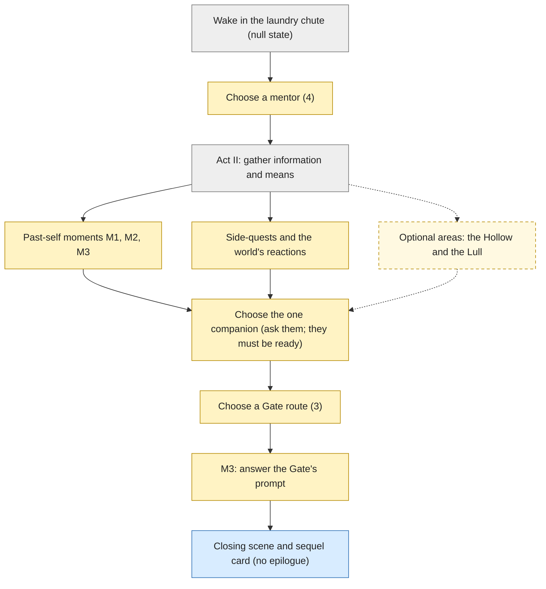
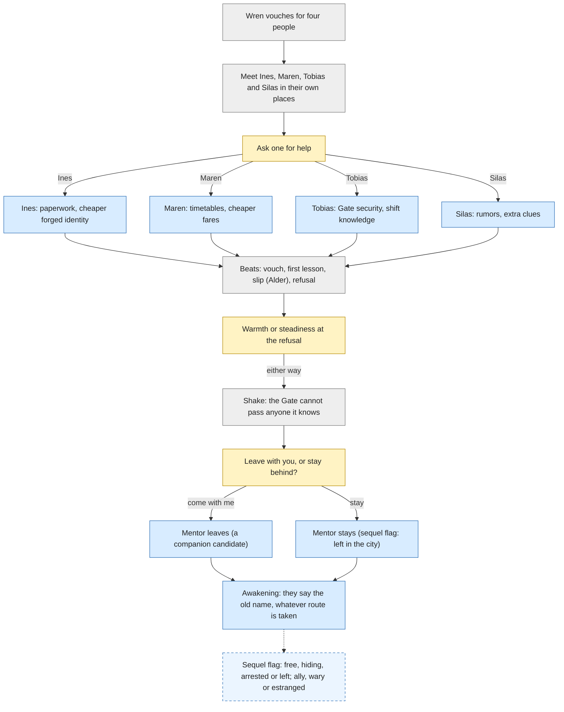
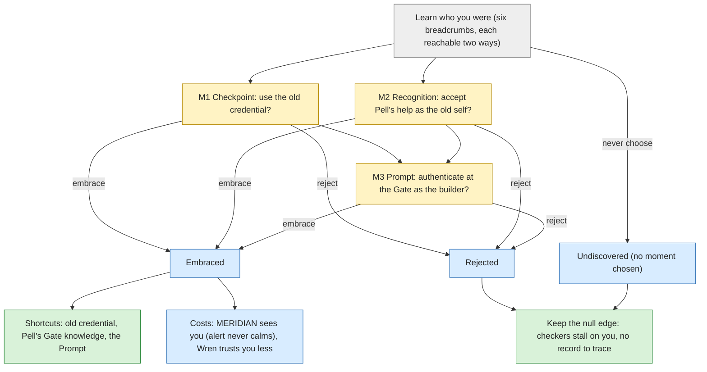
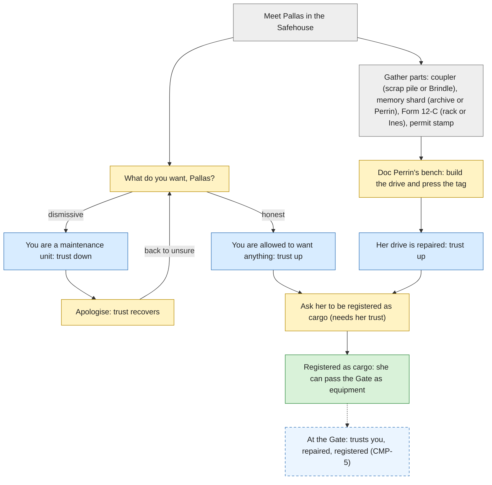
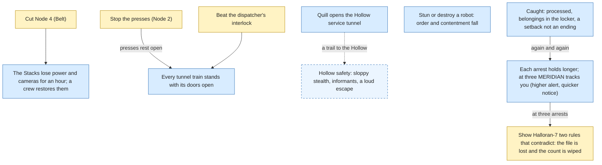
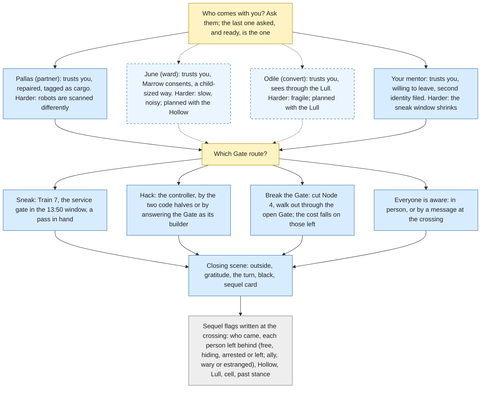
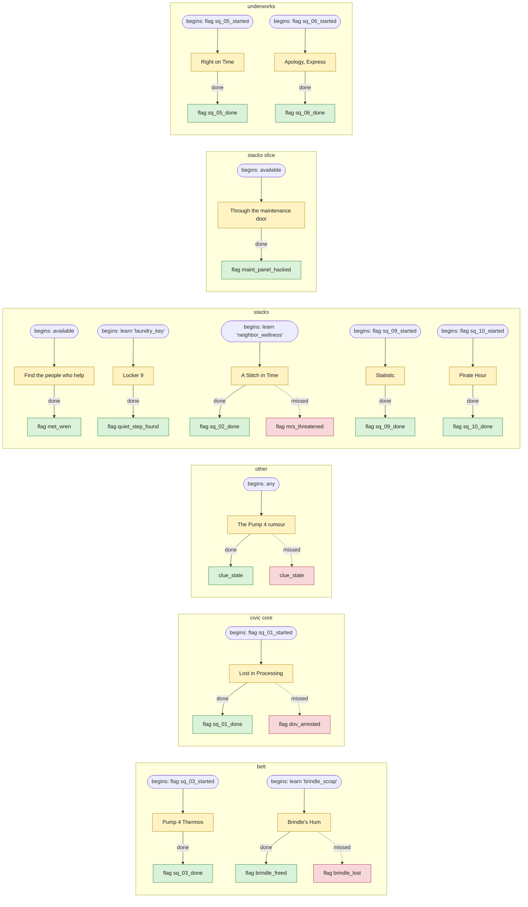

# Decision and achievement tree

*Generated by `pnpm tree -- --write` from `content/design/decisions.json` (the spine), `content/quests` and `content/goals` (the side-quests). Do not edit by hand; a test fails when this file is stale.*

**To update:** change the manifest (add a node, flip `planned` to `implemented` and name its `flag`, add an edge) or the quest data, then run `pnpm tree -- --write`. Implemented nodes that name a flag are checked against the content, so the tree cannot drift from the game. Solid boxes exist today; dashed ones are planned.

Legend: yellow = a decision the player makes; blue = an outcome; green = an achievement or reward; grey = a state or step.

## The whole game at a glance

Solid boxes exist in the game today; dashed boxes are designed and still to be built.

## The mentor

One arc voiced four times. The choice is made once; the beats are the same for everyone; the romance and the leave/stay choices are the player's.

## The past self

Three explicit moments. The majority sets the stance; with one of each, the latest wins. Embracing opens shortcuts at a cost; rejecting keeps the null edge.

## Pallas and the one inventory puzzle

Pallas is a candidate companion. Her trust moves a step at a time and is always recoverable; taking her out needs a repaired drive, a cargo tag and her consent. The parts are the game's single inventory puzzle.

## Choices that change the world

Things the player does that the city, the Belt and the Underworks remember.

## The ending: companion, route, aftermath

One companion, one of three routes, the same closing scene with only the companion's voice changing. A candidate is asked in person and must trust you and meet their practical requirement; each route then asks something more of them. Everyone ends up aware, and the fate of the Hollow, the Lull, the cell, Pallas and each person left behind is written as sequel flags, shown only lightly.

## Side-quests and their outcomes

Derived from the quest data: how each begins, how it is completed, and whether it can fail.

## Achievements

| Achievement | Where it comes from | Status |
|---|---|---|
| Help Dov Anselm with his sister's file (Lost in Processing) | side-quest `sq_01` (civic core) | implemented |
| Settle things with Mrs. Adeyemi-Roth (A Stitch in Time) | side-quest `sq_02` (stacks) | implemented |
| Return Gus Varga's thermos (Pump 4 Thermos) | side-quest `sq_03` (belt) | implemented |
| Save Brindle from the scrap queue (Brindle's Hum) | side-quest `sq_04` (belt) | implemented |
| Learn the tunnel trains (Right on Time) | side-quest `sq_05` (underworks) | implemented |
| Fix the Conductor's timetable (Apology, Express) | side-quest `sq_06` (underworks) | implemented |
| Bring Anecdote home to Doc Perrin (Statistic) | side-quest `sq_09` (stacks) | implemented |
| Play the forbidden song on the Civic Voice (Pirate Hour) | side-quest `sq_10` (stacks) | implemented |
| Both embrace and reject are playable | flag `past_stance` | implemented |
| Met all four mentors | flag `met_tobias` | implemented |
| The Hollow is never found | to be designed | planned |
| Everyone you could help, helped (all ten side-quests) | to be designed | planned |
